# ICT Management Toolkit

One place for everything a company's IT department needs to know and do: tickets, assets, applications, risks, continuity plans, audits and documentation, all linked to each other. Self-hosted and open source (AGPL-3.0-or-later).

An incident links to the server it took down, the server to the application it runs, the application to the business process that depends on it, the process to its continuity plan, and the risks and audit controls to all of them. Work done in one module becomes evidence in another.

## Modules

| Module | What it covers |
|---|---|
| **Service desk** | Incidents, service requests, problems and changes (ITIL 4), with SLAs, a self-service portal, a change advisory board and tickets by email |
| **CMDB** | Configuration items and their relationships, impact analysis, a dependency map |
| **Assets** | Hardware life cycle, handovers, QR labels, software licences and their compliance |
| **Data centre** | Racks, cabling, power chains, IP addresses and VLANs |
| **Applications** | The portfolio, with a versioned and approved documentation sheet for each application |
| **Business impact analysis** | Business processes, impact over time, RTO and RPO, recovery gaps |
| **Continuity** | Continuity and recovery plans, runbooks, exercises, activation log |
| **Risk** | Risk register with a configurable method, heat maps, treatment, risks suggested by the other modules |
| **Audit & compliance** | ISO/IEC 27001, NIS2, GDPR and DORA requirements, controls, evidence, audits and findings |
| **Documentation** | Versioned pages, approval for controlled spaces, help articles for employees |
| **Projects** | Phases, task boards, sponsor gates, status reports, budget |
| **Reporting** | Dashboards by role, trends, a monthly management report |

They share one core: several organizations in one installation with their data kept apart, people and roles, suppliers and contracts, locations, comments and attachments.

The full list is in [Features](docs/features.md).

## Screenshots

From the demo described below, with made-up data. Click a picture to see it full size.

<table>
  <tr>
    <td width="50%"><a href="docs/screenshots/service-desk.png">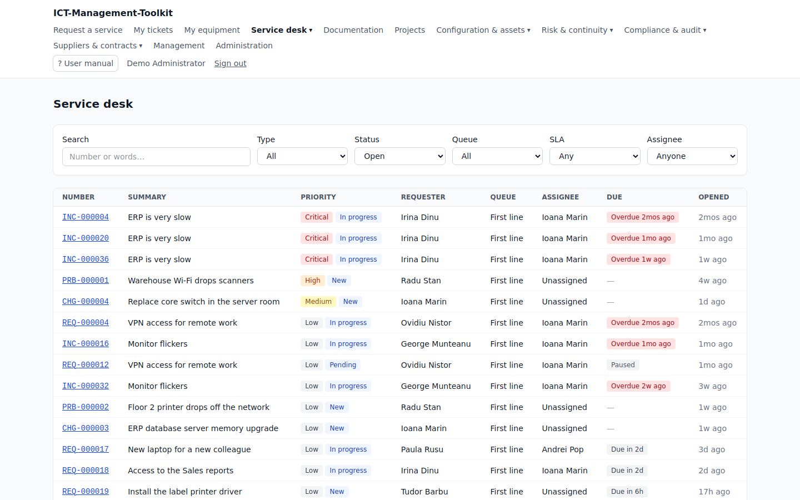</a><br><b>Service desk</b><br>Tickets with priority, status and SLA</td>
    <td width="50%"><a href="docs/screenshots/cmdb.png">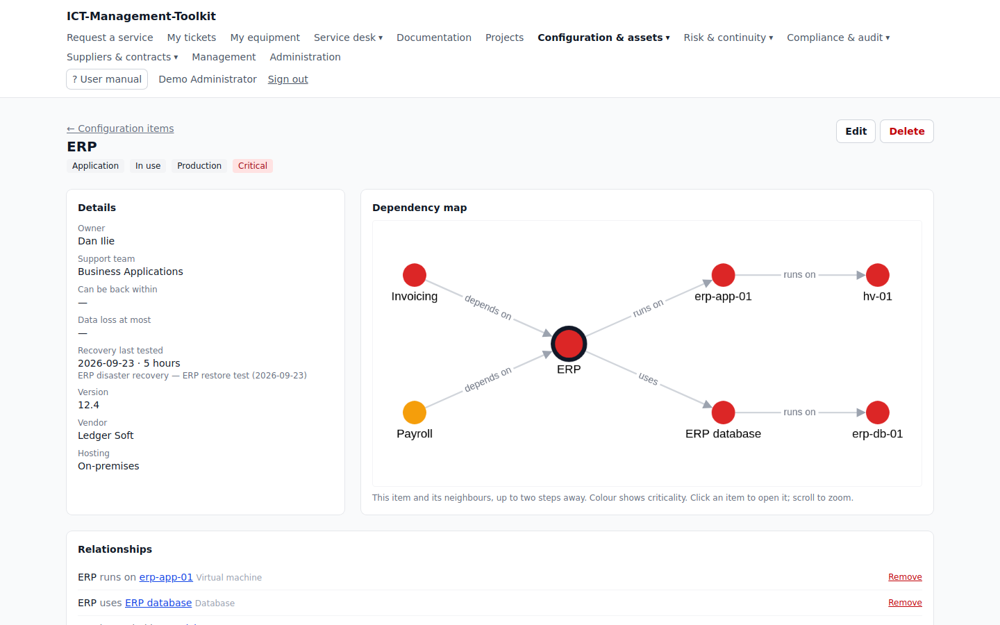</a><br><b>CMDB</b><br>A configuration item and its dependency map</td>
  </tr>
  <tr>
    <td width="50%"><a href="docs/screenshots/assets.png">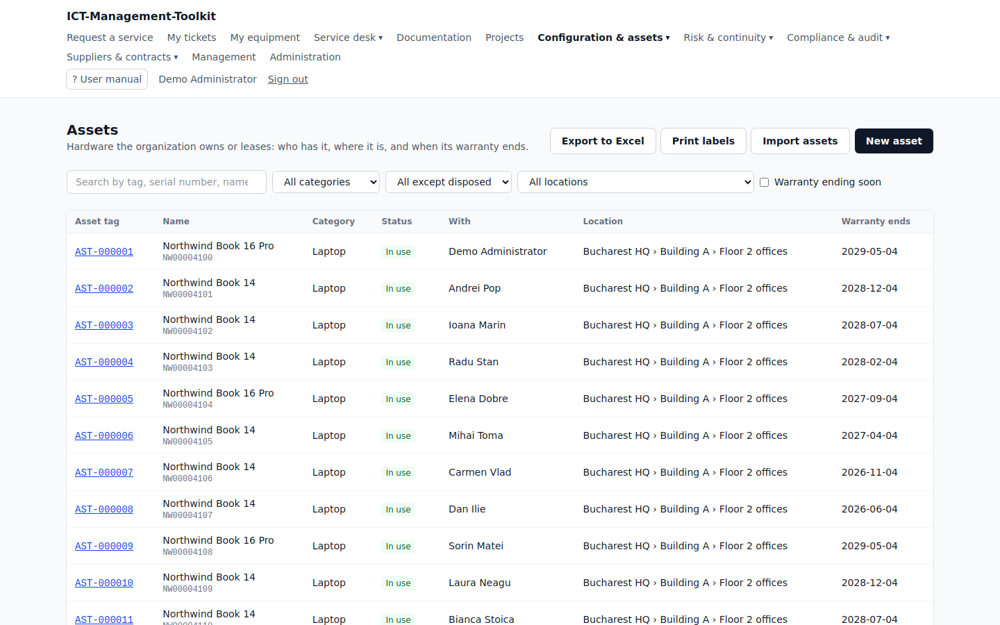</a><br><b>Assets</b><br>Equipment, who has it and when its warranty ends</td>
    <td width="50%"><a href="docs/screenshots/data-centre.png">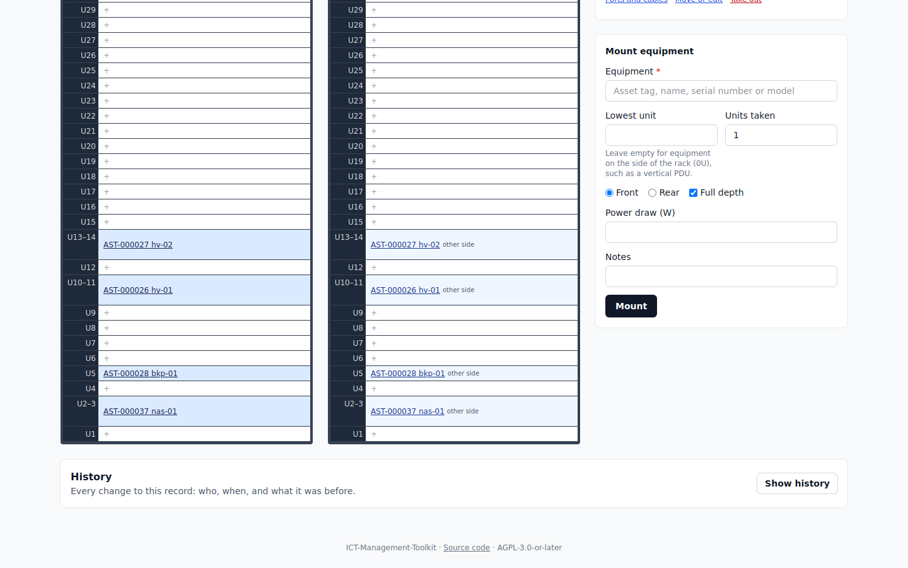</a><br><b>Data centre</b><br>A rack, front and rear</td>
  </tr>
  <tr>
    <td width="50%"><a href="docs/screenshots/applications.png">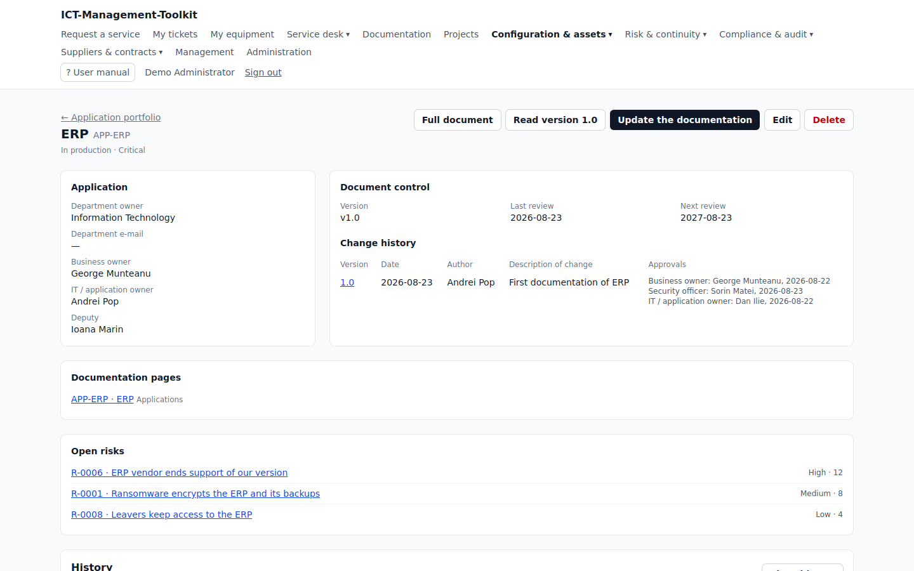</a><br><b>Applications</b><br>An application's owners, approvals and open risks</td>
    <td width="50%"><a href="docs/screenshots/business-impact-analysis.png">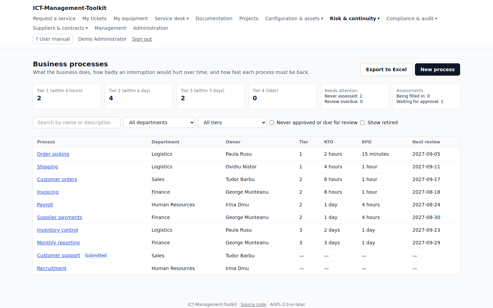</a><br><b>Business impact analysis</b><br>Business processes with their RTO and RPO</td>
  </tr>
  <tr>
    <td width="50%"><a href="docs/screenshots/continuity.png">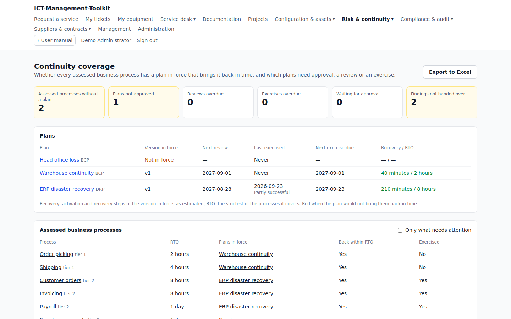</a><br><b>Continuity</b><br>Whether the plans bring each process back in time</td>
    <td width="50%"><a href="docs/screenshots/risk.png">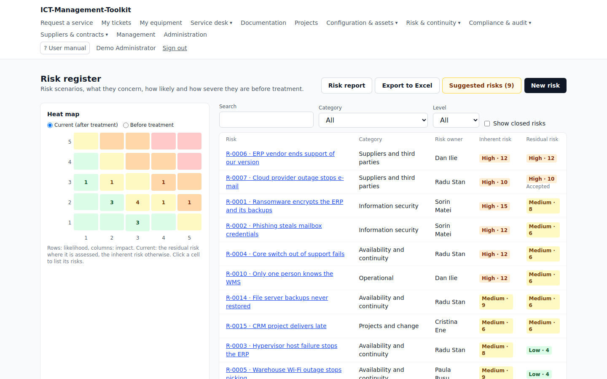</a><br><b>Risk</b><br>The heat map and the risk register</td>
  </tr>
  <tr>
    <td width="50%"><a href="docs/screenshots/compliance.png">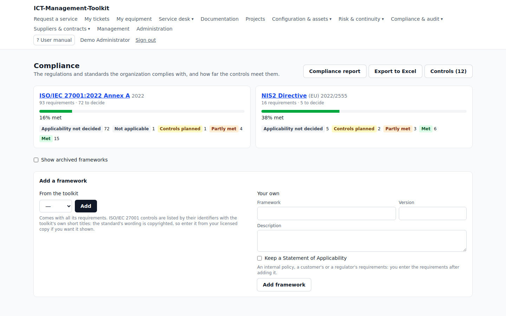</a><br><b>Audit & compliance</b><br>How far the controls meet each framework</td>
    <td width="50%"><a href="docs/screenshots/documentation.png">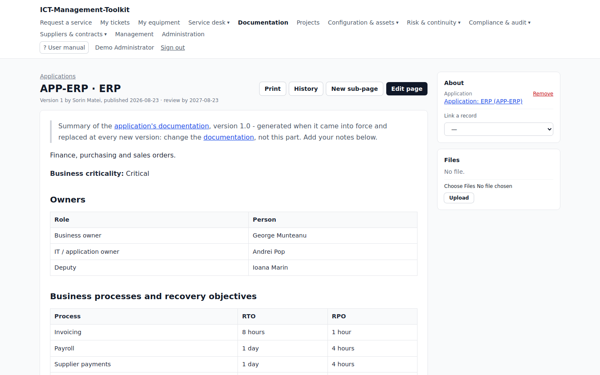</a><br><b>Documentation</b><br>A page generated from an application's documentation</td>
  </tr>
  <tr>
    <td width="50%"><a href="docs/screenshots/projects.png">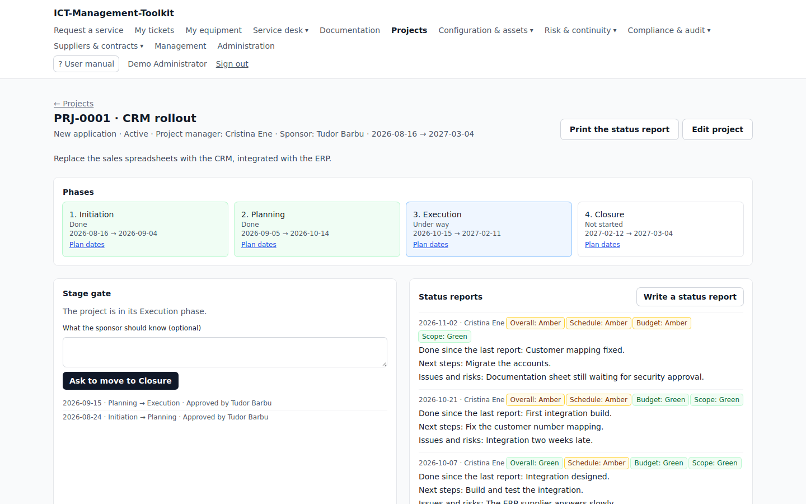</a><br><b>Projects</b><br>Phases, sponsor gates and status reports</td>
    <td width="50%"><a href="docs/screenshots/reporting.png">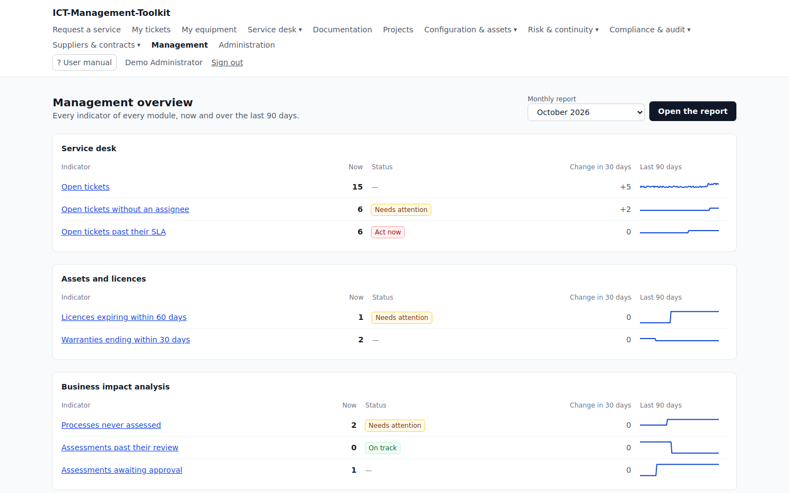</a><br><b>Reporting</b><br>Every indicator, now and over the last 90 days</td>
  </tr>
</table>

## Security

| Feature | What you get | Standard it follows |
|---|---|---|
| **Multi-factor authentication** | Authenticator app codes with recovery codes, security keys and passkeys. Required for IT staff by default; each organization chooses the roles. | RFC 6238 (TOTP), W3C WebAuthn / FIDO2, NIS2 Art. 21(2)(j), DORA Art. 9(4)(d) |
| **Password policy** | At least 15 characters, or 12 with two-factor authentication; passwords known from data breaches refused. No forced mix of symbols by default; an organization can require upper and lower case, digits and symbols when an audit demands it | NIST SP 800-63B-4 (requiring a mix departs from it) |
| **Protection against guessing** | Limits on sign-in attempts, account locked after 10 failures in a row, an email to the person | NIST SP 800-63B |
| **Single sign-on** | OpenID Connect and SAML per organization, Active Directory over LDAPS, roles from groups | OpenID Connect 1.0, SAML 2.0 |
| **Access control** | Permissions checked on every action, 13 default roles, nobody approves their own work, organizations kept apart | NIS2 Art. 21(2)(i), ISO/IEC 27001 A.5.15-5.18 |
| **Audit trail** | Every change, sign-in, role change and export, with old and new values; the database refuses edits and deletions | ISO/IEC 27001 A.8.15 |
| **Secrets** | Mailbox passwords, licence keys, two-factor and single sign-on secrets encrypted at rest and never logged; a licence key is shown only after a fresh code, and that is recorded | OWASP ASVS (design target) |
| **Web protections** | Strict Content Security Policy, HSTS and other security headers, CSRF protection, uploads checked by content, outgoing connections kept off internal addresses | OWASP Top 10 |
| **Personal data** | Export of what is held about a person, anonymization, retention periods per organization | GDPR Art. 15, 17, 20 |

Following a standard here means built to its requirements. Nothing has been certified or audited by a third party: see [Standards and compliance](docs/compliance.md). NIS2 and DORA set obligations for your organization, not password rules; these features help you meet them.

## Integrations

- **REST API** at `/api/v1`, with tokens limited to chosen abilities
- **Signed webhooks** for events from tickets, changes, the CMDB, assets, risks, findings and continuity plans
- **Monitoring alerts** that open and resolve incidents, in the toolkit's own format or from [Prometheus Alertmanager](https://prometheus.io/docs/alerting/latest/alertmanager/)
- **Email to ticket** from IMAP mailboxes, and **imports** from CSV or Excel

## Try it on your computer

This installs a demo with made-up data, so you can look around. It takes one command at a time, and you can copy and paste each one. Nothing here needs PHP or a database on your computer: they all run inside Docker, a program that keeps them in their own containers.

### 1. Get the tools

- **Windows:** open PowerShell as administrator, run `wsl --install`, and restart. This gives you **Ubuntu**, a Linux terminal. Install [Docker Desktop](https://www.docker.com/products/docker-desktop/), and in its settings turn on the integration with Ubuntu (Settings → Resources → WSL integration). Type all the commands below in the Ubuntu window.
- **Mac:** install [Docker Desktop](https://www.docker.com/products/docker-desktop/) and open it. Type the commands in the Terminal app.
- **Linux:** install [Docker Engine](https://docs.docker.com/engine/install/) and [Git](https://git-scm.com/downloads).

To check that everything is ready, run these. Each should print a version number:

```bash
docker --version
git --version
```

### 2. Download the toolkit

```bash
git clone https://github.com/cosmin-andrei-ro/ICT-Management-Toolkit.git
cd ICT-Management-Toolkit
cp .env.example .env
```

This makes a folder with the code, moves you into it, and creates `.env`, the file that holds the settings. The defaults are fine for a demo.

### 3. Install and start it

Run these one at a time, and wait for each to finish:

```bash
docker run --rm -u "$(id -u):$(id -g)" -v "$(pwd)":/var/www/html -w /var/www/html laravelsail/php84-composer:latest composer install --ignore-platform-reqs
./vendor/bin/sail up -d
./vendor/bin/sail artisan key:generate
./vendor/bin/sail artisan migrate --seed
./vendor/bin/sail npm install
./vendor/bin/sail npm run build
```

In order, they download the libraries, start the containers, create a secret key, create the database with the demo data, and build the pages' styles and scripts. The first `sail up -d` can take many minutes, because it downloads and builds everything. Later starts take seconds.

### 4. Open it

Go to **http://localhost** in your browser. Every demo account has the password `password`:

- **`employee@example.com`** sees what an employee sees. It signs in with just the password, so start here.
- **`admin@example.com`** sees everything, and also asks for a six-digit code. In an authenticator app on your phone (Google Authenticator, for example), add an account by entering a key manually, and type `JBSWY3DPEHPK3PXPJBSWY3DPEHPK3PXP`, time-based. The app then shows the code.

Emails the toolkit sends do not really go out: you can read them at http://localhost:8025. To have emails and exports processed, keep this running in a second terminal, in the same folder: `./vendor/bin/sail artisan queue:work`.

The other demo accounts are in [Development setup](docs/development/getting-started.md).

### Stop and start it again

```bash
./vendor/bin/sail stop     # stops it; your data stays
./vendor/bin/sail up -d    # starts it again, from the same folder
```

### If something goes wrong

| What you see | What to do |
|---|---|
| `Cannot connect to the Docker daemon` | Docker is not running. Open Docker Desktop, or on Linux run `sudo systemctl start docker`. |
| `permission denied` when running `docker` (Linux) | Run `sudo usermod -aG docker $USER`, then log out and back in. |
| `port is already allocated` or `address already in use` | Another program uses that port, often port 80. Add `APP_PORT=8080` to the end of `.env`, set `APP_URL=http://localhost:8080` in it, run `./vendor/bin/sail up -d` again, and open http://localhost:8080. |
| `Connection refused` during `migrate` | The database is still starting. Wait 30 seconds and run the command again. |
| `Unable to locate file in Vite manifest` | Run `./vendor/bin/sail npm run build` again. |
| `No such file or directory` for `./vendor/bin/sail` | You are in the wrong folder, or the first command in step 3 failed. Run `cd ICT-Management-Toolkit`, then that command again. |

## Install it on a server

This is for real use, so people in your company can reach it. **Do not use the steps above for this:** the demo passwords are public. You need someone comfortable with a Linux server, because a badly set up server puts your company's data at risk.

**You need:**

- a Linux server with [PHP](https://www.php.net) 8.3 or later, [Composer](https://getcomposer.org), [PostgreSQL](https://www.postgresql.org) 18 (no other database works), [Redis](https://redis.io) 7 or later, [Node.js](https://nodejs.org) 20 or later, and [nginx](https://nginx.org) or [Apache](https://httpd.apache.org) with [PHP-FPM](https://www.php.net/manual/en/install.fpm.php);
- a name such as `ictmt.example.com` that points to the server, with an HTTPS certificate;
- an email account the toolkit can send from (SMTP).

Optional: Active Directory, a mailbox for tickets by email (IMAP), and [Gotenberg](https://gotenberg.dev) for PDFs.

**The steps, in short:**

1. Create an empty PostgreSQL database and a user for it.
2. Download the code and build it: `composer install --no-dev --optimize-autoloader`, then `npm ci && npm run build`.
3. Copy `.env.example` to `.env`, and fill in the address, database, Redis and email settings.
4. Set up the application: `php artisan key:generate`, `php artisan migrate --force`, `php artisan core:permissions:sync`.
5. Create the first administrator by answering the questions of `php artisan core:setup`.
6. Run `php artisan optimize`, and point the web server to the `public/` folder.
7. Start the two background processes, the scheduler and the queue worker. Without them no email goes out and no export is ready.
8. Sign in. The toolkit asks the administrator to set up two-factor authentication.

**Back up `.env`** together with the database: stored secrets cannot be read without the key in it.

[Installation and operation](docs/installation.md) explains each step, with every command and setting, and covers Active Directory, email, updating and backups.

## Standards

The toolkit is **not certified** and has not been audited by a third party. It gives you the records, workflows and evidence that NIS2, DORA, GDPR, ISO/IEC 27001 and ISO 22301 ask for, but compliance also depends on your own processes. [Standards and compliance](docs/compliance.md) says what is in place and what is not, requirement by requirement. Single logout (SAML) is not done yet.

## Documentation

- **User manual:** `/manual` in the running application
- **API:** `/docs/api` in the running application (for people with access to the administration panel), or [the OpenAPI file](docs/api/openapi.json)
- **Modules:** [how each one is built](docs/modules/)
- **Decisions:** [architecture decision records](docs/adr/)
- **Contributing:** [the guide for people and AI agents](CLAUDE.md), and [development setup](docs/development/getting-started.md)

## Built with

- **Application:** [Laravel](https://laravel.com), [Livewire](https://livewire.laravel.com), [Filament](https://filamentphp.com), [Alpine.js](https://alpinejs.dev), [Tailwind CSS](https://tailwindcss.com), [Vite](https://vite.dev), [Cytoscape.js](https://js.cytoscape.org)
- **Data:** [PostgreSQL](https://www.postgresql.org), [Redis](https://redis.io)
- **Sign-in and API:** [Sanctum](https://laravel.com/docs/sanctum), [laravel-permission](https://spatie.be/docs/laravel-permission), [LdapRecord](https://ldaprecord.com), [php-saml](https://github.com/SAML-Toolkits/php-saml), [WebAuthn Framework](https://github.com/web-auth/webauthn-framework), [JWT Framework](https://web-token.spomky-labs.com), [Scramble](https://scramble.dedoc.co)
- **Documents and mail:** [Gotenberg](https://gotenberg.dev), [OpenSpout](https://github.com/openspout/openspout), [php-qrcode](https://github.com/chillerlan/php-qrcode), [ImapEngine](https://github.com/Directorytree/ImapEngine)
- **Development:** [Laravel Sail](https://laravel.com/docs/sail), [Pest](https://pestphp.com), [PHPUnit](https://phpunit.de), [Mockery](https://github.com/mockery/mockery), [Faker](https://fakerphp.org), [PHPStan](https://phpstan.org), [Larastan](https://github.com/larastan/larastan), [Laravel Pint](https://laravel.com/docs/pint), [Laravel Boost](https://laravel.com/docs/boost), [Pail](https://github.com/laravel/pail), [Pao](https://github.com/laravel/pao), [Tinker](https://github.com/laravel/tinker), [Collision](https://github.com/nunomaduro/collision), [concurrently](https://github.com/open-cli-tools/concurrently)

## License

The toolkit is free software under the [GNU Affero General Public License, version 3 or later](LICENSE) (AGPL). The AGPL is the GNU GPL version 3 with one rule added, for software people use over a network.

**You may**, free of charge and for any purpose, including commercial use:

- use the toolkit;
- read and change its code;
- share copies, changed or not.

**In return:**

- **If you give someone a copy** (same as the GPL), give them the source code too, under this same license, and keep the copyright and license notices.
- **If you changed the code and people use your version over a network** (the rule the AGPL adds, section 13), offer those people its source code. This includes your own employees using a changed version on your internal network. The interface already shows a link to the source: point it to your version with the `APP_SOURCE_URL` setting.
- **If you run it unchanged**, you owe nothing more.

**There is no warranty:** you use it at your own risk.

This is a summary to help you, not legal advice, and only the [license text](LICENSE) is binding.
